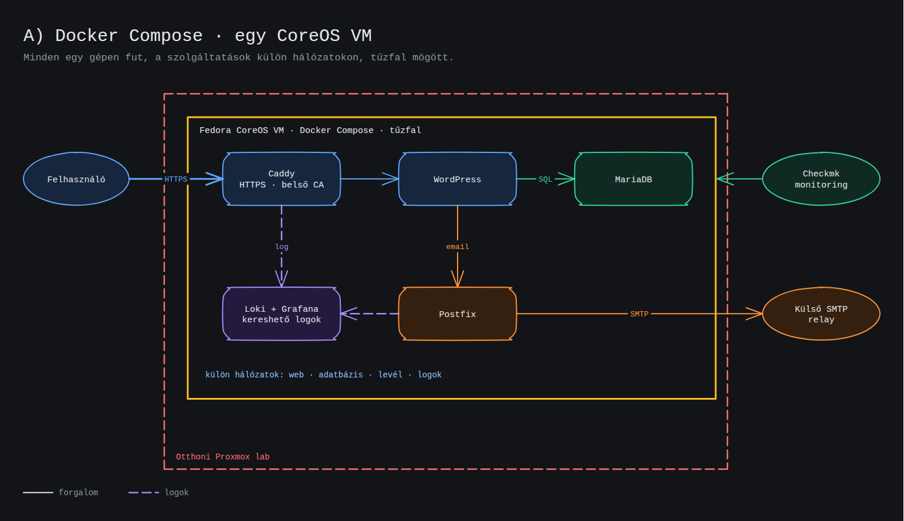

# CoreOS Platform Lab

Reprodukálható, egygépes konténerplatform, amely egy állásra jelentkezéshez kapott gyakorlati feladat megoldásaként készül. Egy Proxmoxon futó Fedora CoreOS VM futtatja a Docker CE-t és egy Docker Compose stacket: belső HTTPS-en elérhető WordPress, amely Postfix relayen keresztül küld levelet; a webes és levelezési események Grafanában kereshetők, a rendszert külső Checkmk figyeli.

A repó a végeredmény mellett a fejlesztési folyamatot is megmutatja: verziókezelt konfiguráció, issue-k és PR-ek, valamint rögzített bizonyíték arról, hogy az egyes követelmények működnek.

## Állapot

**Megtervezve; még nincs megépítve és nincs tesztelve.**

- A repó jelenleg tervet, ábrákat és fejlesztési eszközkonfigurációt tartalmaz.
- Platformkonfiguráció (Butane, Compose, Caddyfile, tűzfalszabályok), teszt és bizonyíték még nincs.
- Egyetlen követelmény sem tekinthető teljesítettnek, amíg az átvételi ellenőrzése le nem futott a laboron, és a bizonyítéka be nem került a repóba.

## Kötelező érvényű scope-döntések (2026-11-13)

A feladat értékelőjének válaszai alapján:

1. **Docker Compose egyetlen VM-en**, egy vagy több Compose-projektként. Klaszter nem kell.
2. **Docker CE**, nem a Fedora CoreOS-ben gyárilag meglévő Moby engine.
3. **A hosttűzfal réteg kötelező.** A Proxmox-tűzfal és a Docker-hálózatok szerinti elkülönítés szívesen látott kiegészítés.

## Dokumentáció

| Dokumentum | Tartalom |
|---|---|
| [docs/architecture.md](docs/architecture.md) | Az elfogadott terv: követelmények, szolgáltatások, hálózat és tűzfal, átvételi ellenőrzések |
| [docs/alternatives/swarm.md](docs/alternatives/swarm.md) | Az elvetett Docker Swarm változat, csak háttéranyagként |
| [diagrams/](diagrams/) | Ábrák három formátumban (Excalidraw, SVG, PNG) és a generátoraik; leírás: [diagrams/SOURCES.txt](diagrams/SOURCES.txt) |
| [docs/.prepare/README.md](docs/.prepare/README.md) | Előkészítő munkaanyag (angolul): döntésnapló, nyitott kérdések, tervfelülvizsgálat, megvalósítási terv |

## Korlátok

A VM, a tárolója és a Proxmox host egyetlen hibapont. Ez nem magas rendelkezésre állású rendszer: a host újraindítása szolgáltatáskiesés. A labor belső hálózaton működik, nyilvános internetes elérés és nyilvános tanúsítvány nélkül.
