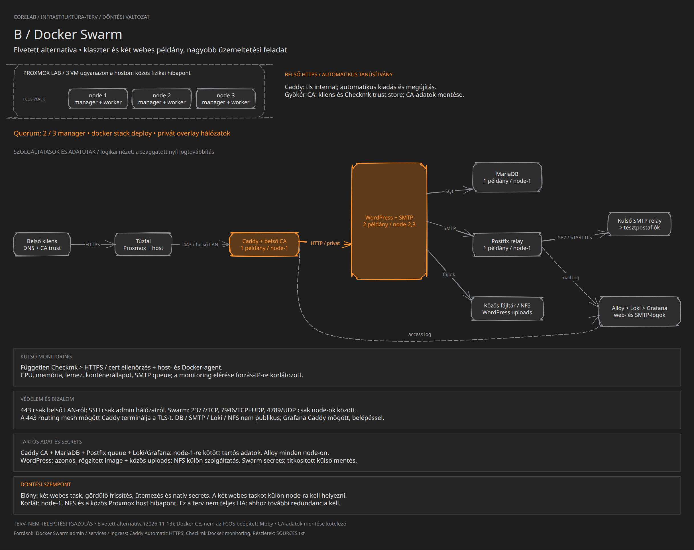

# B változat — Fedora CoreOS és Docker Swarm

**Állapot:** elvetve (2026-11-13). A kolléga egy VM-et és Compose-t kért, klaszter nem kell. Csak háttéranyag, továbbfejlesztési lehetőségként.  
**Cél:** a pályázati szolgáltatások mellett klaszterkezelés, replikaelhelyezés és frissítés bemutatása.  
**Korlát:** a terv nem teljes magas rendelkezésre állású rendszer.  
**Egyszerűbb alternatíva:** [Docker Compose architektúra](../architecture.md).

## 1. Áttekintés

Három Proxmoxon futó Fedora CoreOS VM alkotja a Swarm-klasztert. Mindhárom manager és worker szerepet is betölt. A WordPress két példányban fut, a közös feltöltéseket NFS-fájltár biztosítja. A Caddy, az adatbázis, a levelezés és a központi logtárolás egyetlen, node-hoz kötött példány marad.

[Nagyítható SVG](../../diagrams/02-swarm-dark.svg) · [Szerkeszthető Excalidraw](../../diagrams/02-swarm-dark.excalidraw)

A diagram logikai szolgáltatásnézetet és fizikai VM-topológiát mutat. Az NFS külön NAS vagy storage VM; nem a Swarm által automatikusan biztosított tároló. A kliens, SMTP relay, Checkmk és mentési cél külső függőség.

## 2. Követelmények és választási indok

| Követelmény | Tervezett megoldás | Compose-hoz képesti többlet |
|---|---|---|
| Fedora CoreOS és Docker | Három azonos alapból előállított VM | Node-életciklus és egységes konfiguráció |
| Webes szolgáltatás | Két WordPress task, egy MariaDB | Elhelyezés, közös fájltár és verzióazonosság |
| Reverse proxy és belső CA | Egy Caddy, `tls internal` | Tudatosan node-hoz kötött CA-adat |
| Postfix SMTP | Egy relay task, tartós queue | Elhelyezési constraint és adatkezelés |
| Kereshető logok | Node-onként Alloy, központi Loki/Grafana | Több node logjainak azonosítása |
| Külső monitoring | Checkmk node- és service-ellenőrzések | Quorum, replikaeltérés, pending taskok |
| Tűzfal | Proxmox-, host- és overlay-határok | Klaszterportok és routing mesh vizsgálata |
| Secrets | Natív Swarm secrets | Központi, szolgáltatásonkénti átadás |
| Frissítés | Kontrollált service update | Replikák egymás utáni frissítése |

A kiírás önmagában nem követeli meg a Swarmot. Ezt a változatot akkor érdemes választani, ha a kötelező elemek mellett a klaszterüzemeltetés bemutatása is cél, és van idő a többletfüggőségek kipróbálására.

A „Docker CE” elvárás kérdése eldőlt (2026-11-13): Docker CE kell, nem a Fedora CoreOS beépített Moby-alapú Docker Engine-je. A telepítés módját az elfogadott terv írja le: [Compose architektúra, 2. szakasz](../architecture.md#2-követelmények-és-döntések). [Fedora CoreOS dokumentáció](https://github.com/coreos/fedora-coreos-docs/blob/main/modules/ROOT/pages/running-containers.adoc)

## 3. Node-topológia és vezérlősík

| Node | Szerep | Tervezett workload |
|---|---|---|
| `node-1` | Manager + worker | Caddy, MariaDB, Postfix, Loki, Grafana, Alloy |
| `node-2` | Manager + worker | WordPress task, Alloy |
| `node-3` | Manager + worker | WordPress task, Alloy |
| Külső NFS | Tárolási függőség | Közös WordPress uploads |
| Külső Checkmk | Monitoring | Node-ok és szolgáltatások ellenőrzése |

A három managerből kettő szükséges a quorumhoz. Egy manager elvesztése mellett a vezérlés működhet; quorumvesztéskor a már futó taskok tovább futhatnak, de az ütemezés és módosítás nem működik rendesen. A három VM ugyanazon a Proxmox hoston nem ad fizikai hibatűrést. [Swarm üzemeltetési útmutató](https://docs.docker.com/engine/swarm/admin_guide/)

Mindhárom VM stabil IP-címet, azonos CoreOS-alapkonfigurációt és ellenőrzött Docker-verziót kap. Butane/Ignition adja a kezdeti konfigurációt. A klaszterhez csatlakoztatás külön védett lépés: join token nem kerül Gitbe vagy nyilvános provisioning-fájlba.

A manager+worker együttfutás tudatos labkompromisszum. CPU-, memória- és lemezkorlátokkal meg kell akadályozni, hogy az alkalmazás vagy logtároló kiszorítsa a vezérlősíkot.

## 4. Stack és szolgáltatáselhelyezés

A telepítés manager node-ról, `docker stack deploy` használatával történik. A stackfájl nem tekinthető egy tetszőleges modern Compose-fájl változtatás nélküli megfelelőjének; a Swarm által támogatott formátumot külön validálni kell. Saját image előre felépítve, minden node-ról elérhető registrybe kerül, rögzített verzióval vagy digesttel. [Stack telepítése](https://docs.docker.com/engine/swarm/stack-deploy/)

| Szolgáltatás | Példány / mód | Elhelyezés és állapot |
|---|---|---|
| Caddy | 1 replica | `node-1`; helyi CA- és TLS-adatok |
| WordPress | 2 replica | `node-2` és `node-3`; legfeljebb egy webes task node-onként |
| MariaDB | 1 replica | `node-1`; helyi adatbázis-volume |
| Postfix | 1 replica | `node-1`; helyi queue |
| Alloy | Global | Minden megfelelő node-on egy gyűjtő |
| Loki | 1 replica | `node-1`; helyi logadatok |
| Grafana | 1 replica | `node-1`; tartós beállítások |

A stateful szolgáltatások placement constraintje a tényleges adathordozóhoz köti a taskot. Egy másik node ugyanilyen nevű helyi volume-ja nem ugyanaz az adat. A Swarm nem replikálja automatikusan ezeket a volume-okat. [Service-elhelyezés és volume-ok](https://docs.docker.com/engine/swarm/services/)

A WordPress image, plugin és theme verziói azonosak. A futó példányok nem módosíthatják egymástól függetlenül a telepített kódot. A közös uploads az NFS-en van, a közös alkalmazásadat a MariaDB-ben. Az adatbázis elérhetőségét az alkalmazás újrapróbálással kezeli; pusztán indítási sorrendre nem támaszkodunk.

Az NFS megosztás csak az engedélyezett klienseknek érhető el, az UID/GID-jogosultságok és SELinux-szabályok dokumentáltak. Az NFS kiesése az uploads használatát akadályozza.

## 5. Kliensút, HTTPS és CA

A lab DNS-ben `app.corelab.test` és `logs.corelab.test` egy dokumentált belépési IP-re, kezdetben `node-1` címére mutat. Ez egyetlen belépési pont; a routing mesh nem helyettesít redundáns DNS/VIP/load balancer kialakítást.

A TCP 443 ingress publikálását követően a routing mesh az aktív Caddy taskhoz irányítja a kérést. Caddy végzi a TLS terminálást, majd a WordPress service felé proxyz. A publikált port más node-címeken is elérhetővé válhat, ezért a tűzfalat mindegyiken ellenőrizni kell. [Swarm routing mesh](https://docs.docker.com/engine/swarm/ingress/)

A Caddy `tls internal` automatikusan kiadja és megújítja a belső tanúsítványokat. A CA-adatok `node-1` tartós tárolóján vannak, a gyökér-CA nyilvános tanúsítványát a kliens és Checkmk megbízhatónak jelöli. A CA privát kulcsát menteni és védeni kell. [Caddy Automatic HTTPS](https://caddyserver.com/docs/automatic-https)

Ebben a változatban szándékosan egyetlen Caddy van: a CA/tanúsítványállapot több példány közötti koordinációját nem tekintjük megoldottnak. A Grafana Caddy mögött, saját belépéssel érhető el. A diagram a Grafana proxyútját nem rajzolja külön.

## 6. Hálózat és tűzfal

Külön overlay hálózatot kap a proxy–web, web–adatbázis, web–SMTP, logbeküldési és Grafana-proxy kapcsolat. A szolgáltatás csak a szükséges hálózatokhoz csatlakozik. A hálózati tagság elkülönítés, nem helyettesíti a szolgáltatáshitelesítést és tűzfalszabályokat.

| Forrás és cél | Port / protokoll | Szabály |
|---|---|---|
| Belső kliens → node-ok publikált HTTPS-e | 443/TCP | Csak belső klienshálózat |
| Admin hálózat → node-ok | 22/TCP | Csak adminisztráció |
| Node-ok → managerek | 2377/TCP | Klasztertagokra korlátozva |
| Node ↔ node | 7946/TCP és UDP | Klasztertagokra korlátozva |
| Node ↔ node | 4789/UDP | Kizárólag megbízható klaszterhálózat |
| Webes node-ok → NFS | A választott NFS-verzió portjai | Csak a megosztás kliensei |
| Checkmk → node-ok / HTTPS | Integráció szerinti portok | Monitoringforrásra korlátozva |
| Postfix → külső relay | 587/TCP | STARTTLS, hitelesítés, kijelölt relay |

Az NFS konkrét protokollverziója és portlistája megvalósítási döntés, nem maradhat korlátlan engedélyezés. Külön DNS-, NTP- és registry-kijárati szabályok készülnek. A TCP 80 csak opcionális belső átirányításra nyílhat meg; a 443/UDP nincs megnyitva az alaptervben. IPv6 esetén egyenértékű védelem szükséges.

A Proxmox VM-határon, a hosttűzfal pedig a tényleges Docker/Swarm forgalmi útvonalakon szűr. Az ingress, overlay, bridge és hostforgalom kezelését külön kell vizsgálni; az egygépes `DOCKER-USER` szabályok átmásolása önmagában nem bizonyítja a Swarm védelmét. A VXLAN-port nem érhető el nem megbízható hálózatból.

Az overlay adatforgalom titkosítását nem szabad pusztán a Swarm használatából feltételezni. Ez az alapterv megbízható, elkülönített labhálózatot feltételez; más környezetben az adatforgalmi titkosítás és annak protokolligénye külön tervezendő.

SELinux aktív marad, a konténerek minimális jogosultságot kapnak. Docker socket vagy más hostszintű agent-hozzáférés kiemelt jogosultságnak számít, read-only mount esetén is.

## 7. SMTP, logok és monitoring

A Postfix csak az engedélyezett alkalmazástól fogad továbbítandó levelet. A dinamikus taskcímek miatt a relayengedélyt dedikált hálózattal és szükség szerint SMTP-hitelesítéssel kell kialakítani; az egész klaszter nem válik automatikusan megbízható klienssé. A levélút: WordPress → Postfix → külső SMTP relay → tesztpostafiók.

A Caddy access log és Postfix-log minden érintett node-on elérhető az Alloy számára. A gyűjtő naplóolvasási állapota tartós; Loki és Grafana a `node-1`-en fut. A logok szolgáltatás- és node-címkét kapnak, a queue ID kereshető tartalom. Rotáció, retention, lemezfigyelés és loggyűjtési kiesésjelzés szükséges. [Alloy és Loki](https://grafana.com/docs/grafana-cloud/send-data/alloy/tutorials/send-logs-to-loki/)

A külső Checkmk az egyes hostok mellett az elvárt service-állapotot is vizsgálja: managerelérhetőség, quorumkockázat, desired/running replikaeltérés, pending taskok, HTTPS és tanúsítvány, NFS, SMTP queue és mentések kora. A klaszterspecifikus ellenőrzésekhez külön local check/API-integráció is szükséges lehet; nem feltételezzük, hogy a Docker alapplugin mindet biztosítja. Az agent CoreOS-kompatibilitását korán tesztelni kell. [Checkmk Docker-monitoring](https://docs.checkmk.com/latest/en/monitoring_docker.html)

## 8. Secrets és mentés

Az adatbázis-, SMTP- és adminhitelesítő adatok Swarm secretsként, szolgáltatásonként engedélyezve jutnak a taskokhoz. A Swarm titkosítja a secrets tárolását és továbbítását, de a futó szolgáltatás felhasználja a titkot; ez nem véd a jogosult szolgáltatás vagy host kompromittálása ellen. A nem érzékeny konfiguráció külön configként kezelhető. [Docker secrets](https://docs.docker.com/engine/swarm/secrets/)

Rotációkor új, verziózott secret készül, a szolgáltatás átáll rá, majd a régi kivezethető. A Caddy által generált CA-állapot továbbra is védett tartós adat, nem automatikusan Swarm secret.

Mentendő adatkörök:

- Konzisztens MariaDB-mentés és hozzá illeszkedő WordPress uploads.
- Caddy CA/TLS-adatok, Grafana-konfiguráció, szükség szerint logadatok.
- Postfix queue dokumentált eljárással; restore esetén duplikált küldés lehetséges.
- Stackek, provisioning, image-azonosítók és secrets védett helyreállítási forrása.
- Swarm vezérlősík-állapot a Docker dokumentált backupeljárásával; bekapcsolt autolock esetén a feloldókulcs külön védett példánya.

A klaszterállapot mentése nem menti automatikusan az alkalmazás-volume-okat vagy az NFS-t. A mentés a klaszteren és lehetőleg a fizikai Proxmox hoston kívül, titkosítva tárolandó. Helyreállítás: node-ok és hálózat → klaszter → secrets/config → NFS és alkalmazásadat → service-ek → működési ellenőrzés. [Swarm backup és recovery](https://docs.docker.com/engine/swarm/admin_guide/)

## 9. Frissítés és hibamódok

A webes taskok egyenként frissülnek. A két engedélyezett node és a node-onként legfeljebb egy replika mellett a kezdeti stratégia `parallelism: 1`, `order: stop-first`; így nem kell egy harmadik szabad elhelyezési helyre várni. A másik webes task kiszolgálhat, de a megszakításmentességet terheléses próbával kell igazolni. Az adatbázis-séma kompatibilitása külön feltétel.

A Caddy, MariaDB, Postfix és Loki egyetlen példányának frissítése kiesést okozhat. Az image rollback nem állítja vissza az adatbázist. A CoreOS-node-okat egymás után, a managerquorum megőrzésével frissítjük. A `node-1` drainje nem költözteti át automatikusan a helyi adatokat; itt tervezett kiesés szükséges.

| Esemény | Várt következmény |
|---|---|
| Egy WordPress task leáll | Az ütemező újraindíthatja; másik példány kiszolgálhat |
| `node-2` vagy `node-3` kiesik | Quorum megmarad, egy webes példány marad; a második a szigorú elhelyezés miatt pending lehet |
| `node-1` kiesik | A quorum még megmaradhat, de CA/proxy, DB, SMTP és logközpont kiesik; az alkalmazás nem használható rendesen |
| Két manager kiesik | Quorumvesztés; nincs normál service-módosítás vagy újraütemezés |
| NFS kiesik | A közös feltöltések elérése hibás vagy blokkolt lehet |
| Proxmox host kiesik | Mindhárom VM kiesik |
| Kliens belépési IP-je kiesik | A routing mesh ellenére nincs automatikus kliensoldali alternatíva |

Teljes HA-hoz több fizikai hibadomén, redundáns belépés, adatbázis- és fájltárstratégia, valamint proxy/CA-állapotkezelés is kellene. Ezek a jelen terven kívüli bővítések.

## 10. Megvalósítás és átvétel

1. A scope egyeztetése megtörtént (2026-11-13): Docker CE, Moby nélkül; egy VM és Compose, Swarm nélkül. Ezért ez a változat nem valósul meg. Megvalósítás esetén itt a Proxmox-, NFS-, relay- és Checkmk-hozzáférés tisztázása következne.
2. Három CoreOS VM, tűzfal, klasztertagság és quorumellenőrzés.
3. Image-ek, secrets, configok, overlay hálózatok és tartós tárolók előkészítése.
4. Stateful szolgáltatások, két WordPress task, HTTPS és email kipróbálása.
5. Logok és monitoring bekötése; frissítés, node-kiesés és restore próbája.

| Ellenőrzés | Elfogadási feltétel |
|---|---|
| Klaszter | Három manager látható, egy kiesésénél quorum megmarad |
| Elhelyezés | Két webes task két külön node-on; stateful taskok a megfelelő adatok mellett |
| Közös uploads | Egyik példányon feltöltött fájl a másikról is elérhető |
| HTTPS és CA | Megbízható lánc; automatikus kiadás és kontrollált megújítás igazolva |
| SMTP és log | Levél megérkezik, queue ID és HTTP-esemény Grafanában kereshető |
| Tiltott relay | Nem engedélyezett kliens nem továbbíthat levelet |
| Tűzfal | Publikált portok minden node-on tesztelve; clusterportok illetéktelen hálózatból zártak |
| Monitoring | Task-/node-hiba és replikaeltérés riasztást okoz |
| Rolling update | Webes taskok egymás után frissülnek; mért hibaarány dokumentált |
| Stateful hiba | `node-1` kiesése a leírt korlátokat mutatja; nincs hamis HA-állítás |
| Restore | DB, uploads és CA visszaáll; RPO/RTO mért eredménye dokumentált |

A végső átadás csak a ténylegesen elvégzett próbákat jelölheti teljesítettnek. A képernyőképek, parancskimenetek, verziók és nyitott hibák a megvalósítás során készülnek el.
