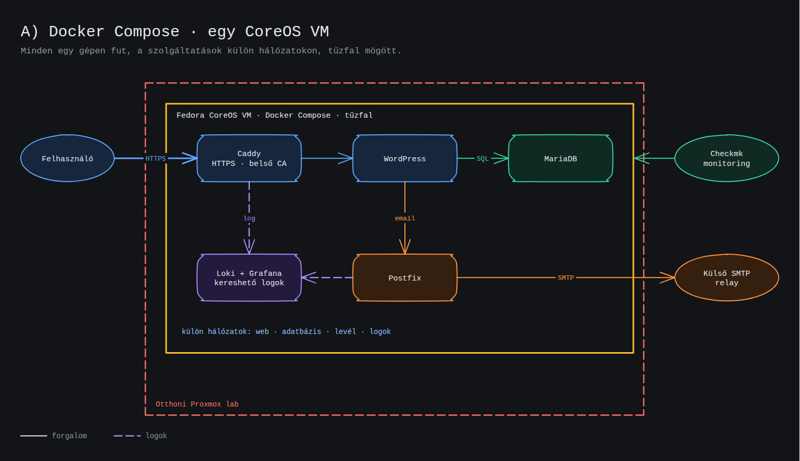
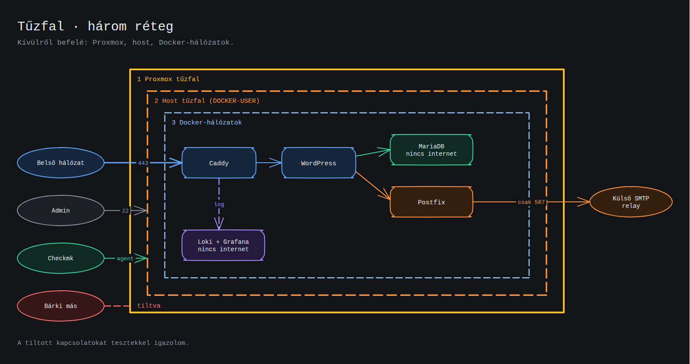

# A változat — Fedora CoreOS és Docker Compose

**Állapot:** megvalósítási terv; nincs telepítéssel igazolva.  
**Döntés (2026-11-13, a kolléga válasza):** egy VM, egy vagy több Compose-projekt; nem kell klaszter. Docker CE, nem Moby. Tűzfal: a host réteg kötelező, a másik két réteg kiegészítés.  
**Cél:** a pályázati feladat kötelező elemeinek reprodukálható, egygépes bemutatása.  
**Elvetett alternatíva:** [Docker Swarm architektúra](alternatives/swarm.md) (csak háttéranyag).

## 1. Áttekintés

Egy Proxmoxon futó Fedora CoreOS VM ad helyet a Docker Engine-nek és a Compose által kezelt szolgáltatásoknak. A bemutatható üzleti folyamat: belső HTTPS-en elérhető WordPress, amely Postfixen keresztül emailt küld; a webes és levelezési események Grafanában visszakereshetők, a rendszer állapotát külső Checkmk figyeli.

[Nagyítható SVG](../diagrams/07-arch-a-compose-dark.svg) · [Szerkeszthető Excalidraw](../diagrams/07-arch-a-compose-dark.excalidraw)

Részletes nézet: [PNG](../diagrams/01-compose-dark.png) · [SVG](../diagrams/01-compose-dark.svg) · [Excalidraw](../diagrams/01-compose-dark.excalidraw)

Az ábra logikai nézet. A Caddy, WordPress, MariaDB, Postfix, Alloy, Loki és Grafana ugyanazon a VM-en fut. A kliens, az SMTP relay, a Checkmk és a mentési cél külső függőség.

## 2. Követelmények és döntések

| Követelmény | Tervezett megoldás | Igazolás |
|---|---|---|
| Fedora CoreOS Proxmox alatt | Butane/Ignition konfigurációval létrehozott VM | Új VM létrehozása ugyanabból a konfigurációból |
| Docker CE környezet | Docker CE a Docker hivatalos repójából, a beépített Moby helyett (`rpm-ostree override`) | `docker version`, `rpm -q docker-ce`, `rpm-ostree status` kimenete |
| Webes szolgáltatás | WordPress és MariaDB | Bejelentkezés, tartalom és feltöltés |
| HTTPS reverse proxy | Caddy | HTTPS elérés és HTTP backend |
| Belső CA és automatizálás | Caddy `tls internal` | Megbízható lánc és automatikus megújítás ellenőrzése |
| SMTP konténer | Postfix relay | Alkalmazásból küldött levél kézbesítése |
| Kereshető logok | Alloy, Loki, Grafana | HTTP-hiba és Postfix queue ID keresése |
| Külső monitoring | Checkmk agent és aktív ellenőrzések | Szolgáltatásleállításból keletkező riasztás |
| Tűzfal és elkülönítés | Kötelező: hosttűzfal (`DOCKER-USER`). Kiegészítés: Proxmox-tűzfal, külön Docker-hálózatok | Pozitív és negatív kapcsolati tesztek |
| Opcionális üzemeltetés | Mentés, secrets, kontrollált frissítés | Visszaállítás és frissítési próba |

A Fedora CoreOS gyárilag a Moby-alapú Dockert (`moby-engine`) tartalmazza; a feladat kifejezetten Docker CE-t kér. A hivatalos FCOS-leírás szerint első bootkor egy egyszer lefutó systemd unit felveszi a Docker repóját, majd `rpm-ostree override remove moby-engine containerd runc docker-cli --install docker-ce` paranccsal lecseréli a csomagokat, és újraindít. A Compose plugint (`docker-compose-plugin`) kifejezetten telepítjük, és a repófájlt a Butane konfiguráció tartalmazza, nem futásidőben töltjük le. [Fedora CoreOS: Installing Docker CE](https://github.com/coreos/fedora-coreos-docs/blob/main/modules/ROOT/pages/docker-ce.adoc)

Kockázat: a felülírt alapcsomagok miatt egy Fedora főverzió-váltás frissítése elakadhat; ez a 40→41 váltásnál meg is történt az új `docker-cli` csomag miatt. Ezért a Zincati csak karbantartási ablakban frissít, frissítés előtt ellenőrizzük a Docker repó támogatását az új Fedora-verzióra, és hiba esetén `rpm-ostree rollback` a visszaút.

## 3. Gép és telepítési modell

- Egy `app-01` nevű Fedora CoreOS VM, stabil IP-címmel és névfeloldással.
- A VM tényleges CPU-, RAM- és lemezméretét a rendelkezésre álló Proxmox-kapacitás és a terhelési próba alapján kell rögzíteni.
- A Butane a verziókezelt konfiguráció forrása; az Ignition a kezdeti gépkonfigurációt adja át. Az Ignition nem folyamatos konfigurációkezelő.
- A Docker CE és a Compose plugin ellenőrzött verziója és csomagforrása (`download.docker.com`, GPG-kulcs) bekerül a telepítési dokumentációba.
- A rendszerindításkor systemd indítja a Compose-projektet a hálózat és a Docker elérhetősége után.
- A tartós adat a CoreOS írható adatterületén, például `/var/lib/corelab` alatt vagy névvel ellátott Docker-volume-okban marad.
- A titkok védett átadással kerülnek a gépre; nyilvánosan elérhető Ignition-fájlba nem kerülnek.

Az első megvalósítás egyetlen Compose-projekt lehet. Ez csökkenti a hálózatok és indítási függőségek koordinációját. Később külön alkalmazási és logolási projektre bontható, dokumentált közös hálózatokkal.

## 4. Szolgáltatások és adatút

| Szolgáltatás | Feladat | Tartós adat |
|---|---|---|
| Caddy | TLS terminálás, WordPress és Grafana proxyzása | CA-kulcsok, tanúsítványok és Caddy-adatok |
| WordPress | Webalkalmazás és SMTP-integráció | Feltöltések; a konfiguráció és bővítmények reprodukálható forrásból |
| MariaDB | WordPress-adatbázis | Adatbázis-volume |
| Postfix | Alkalmazáslevelek továbbítása | Levélqueue; relay-hitelesítő adatok külön secretként |
| Alloy | Web- és SMTP-logok gyűjtése | Olvasási pozíciók és szükséges állapot |
| Loki | Logtárolás és lekérdezés | Logadatok, konfigurált megőrzési idővel |
| Grafana | Kereshető logfelület | Felhasználók és beállítások; adatforrás provisioningból |

Fő adatút: **kliens → Caddy → WordPress → MariaDB**. Emailküldés: **WordPress → Postfix → hitelesített külső SMTP relay → tesztpostafiók**.

A Caddy külön access logot állít elő. A Postfix választott image-e dokumentáltan elérhető stdout- vagy fájllogot ad; ezt nem szabad ellenőrzés nélkül feltételezni. Alloy ezeket továbbítja Lokiba, Grafana pedig Loki-adatforráson keresztül keres. [Alloy és Loki útmutató](https://grafana.com/docs/grafana-cloud/send-data/alloy/tutorials/send-logs-to-loki/)

## 5. DNS, HTTPS és belső CA

Javasolt labnevek: `app.corelab.test` és `logs.corelab.test`. Ezek példanevek; belső DNS vagy a bemutatóhoz dokumentált hosts-bejegyzés oldja fel őket a VM IP-címére.

A Caddy mindkét névnél `tls internal` konfigurációt kap. A kiadás és megújítás automatikus, a Caddy adatkönyvtára tartós. A gyökér-CA nyilvános tanúsítványa bekerül a kliens és a Checkmk bizalmi tárolójába; a CA privát kulcsa nem kerül a kliensekre. A Caddy belső kiadója nem igényel külön ACME-szervert. [Caddy Automatic HTTPS](https://caddyserver.com/docs/automatic-https)

A bemutató nem használhat kikapcsolt tanúsítvány-ellenőrzést. A Grafana felülete HTTPS mögött is hitelesítést igényel. A proxy és az alkalmazás közötti HTTP csak az elkülönített belső hálózaton engedélyezett; teljes végpontok közötti TLS nem része ennek az alaptervnek.

## 6. Hálózati elkülönítés és tűzfal

[Nagyítható SVG](../diagrams/09-tuzfal-dark.svg) · [Szerkeszthető Excalidraw](../diagrams/09-tuzfal-dark.excalidraw)

| Hálózat | Tagok | Megengedett fő kapcsolat |
|---|---|---|
| `web` | Caddy, WordPress | Proxy → alkalmazás |
| `database` | WordPress, MariaDB | Alkalmazás → SQL |
| `mail` | WordPress, Postfix | Alkalmazás → SMTP |
| `logs` | Alloy, Loki, Grafana | Logbeküldés és lekérdezés |
| `grafana-proxy` | Caddy, Grafana | Proxy → logfelület |

Az adatbázis és logtároló hálózata nem kap közvetlen internetes kijáratot. A Postfix számára külön engedélyezett kimenet kell a relayhez; DNS, időszinkron, image-letöltés és alkalmazáskülső kapcsolatok engedélyezése külön szabályokban szerepel. Az `internal` hálózat használatakor az ebből eredő kijárati korlátozásokat tesztelni kell.

| Forrás | Cél | Engedély |
|---|---|---|
| Belső felhasználói hálózat | Caddy | TCP 443 |
| Adminisztrációs hálózat | VM | TCP 22 |
| Checkmk | Hostagent és ellenőrzött végpontok | Csak a választott integráció szükséges portjai |
| Postfix | Külső relay | TCP 587, STARTTLS és hitelesítés |
| Nem engedélyezett kliens | DB, SMTP, Loki, Docker API | Tiltás |

A TCP 80 átirányítás nem feltétel: ha használjuk, csak a belső klienshálózat számára nyitjuk meg. A 443/UDP nincs megnyitva az alaptervben. Az IPv6 vagy az IPv4-gyel egyenértékű szabályokat kap, vagy dokumentáltan nincs használatban.

A kötelező réteg a hosttűzfal; a Proxmox-tűzfal és a Docker-hálózatok szerinti elkülönítés kiegészítő védelem, ezeket is megvalósítjuk és teszteljük. A Proxmox-tűzfal a VM határán szűr. A hosttűzfal a host- és a továbbított konténerforgalmat is kezeli. Az iptables Docker backend esetén a saját továbbítási szabályok helye a `DOCKER-USER` lánc; pusztán az `INPUT` szűrése nem védi a publikált konténerportokat. A szabályok Docker- és hostújraindítás után is fennmaradnak. [Docker és iptables](https://docs.docker.com/engine/network/firewall-iptables/)

A SELinux aktív marad, a bind mountok megfelelő címkézést kapnak. A konténerek csak indokolt jogosultságot és mountot kapnak. Egy read-only Docker socket mount sem tekinthető read-only Docker API-jogosultságnak; az agent/loggyűjtő hozzáférését külön kell korlátozni és dokumentálni.

## 7. SMTP, logok és monitoring

A Postfix csak a kijelölt alkalmazáskliensnek engedélyez relayt. Nincs általánosan publikált SMTP-port, a megbízható hálózatok köre szűk, a tiltott relaykísérlet külön teszteset. Külső SMTP-hozzáférés hiányában tesztfogadó használható, de ez csak a labon belüli kézbesítést bizonyítja.

A Loki címkéi alacsony változatosságú értékek: szolgáltatás, host, környezet. A queue ID és a kérésazonosító kereshető logtartalom marad. A naplórotáció, a Loki megőrzése és a lemezriasztás együtt akadályozza meg a lemez megtelését. A retention konkrét értéke a kapacitás függvényében kerül beállításra.

A Checkmk lehetőleg más fizikai gépen vagy meglévő külső infrastruktúrán fut. Ellenőrzései: host erőforrások, Docker- és konténerállapot, HTTPS válasz és tanúsítvány, Postfix queue, mentések kora. A queue és mentés állapotához szükség esetén helyi ellenőrző script készül. A Linux agent és Docker plugin CoreOS-ra illesztése korai megvalósítási próba. [Checkmk Docker-integráció](https://docs.checkmk.com/latest/en/monitoring_docker.html)

## 8. Secrets, mentés és helyreállítás

A Compose secrets szolgáltatásonként engedélyezett fájlokat ad át. A forrásfájlokat védeni kell, és nem kerülhetnek Gitbe; a Compose ezen használata nem ad automatikus titkosítást a hoston. [Compose secrets](https://docs.docker.com/compose/how-tos/use-secrets/)

Mentendő: konzisztens MariaDB-mentés, WordPress-feltöltések, Caddy CA és konfiguráció, Grafana-beállítások, titkok helyreállításához szükséges védett anyagok. A Postfix queue mentésének/visszaállításának duplikált levélküldési kockázatát az eljárás külön kezeli. A logok mentése és megőrzése külön döntés.

A mentés titkosított és a VM-en kívül van; ugyanazon a fizikai hoston tartott másolat nem véd host- vagy tárolóvesztés ellen. Adatbázisnál az élő volume egyszerű másolása nem konzisztens mentési eljárás. A VM-snapshot kiegészítő visszaállítási lehetőség.

Helyreállítási sorrend: VM és hálózat → Docker/Compose → titkok és CA → adatbázis és feltöltések → szolgáltatások → HTTPS, email, log és monitoring ellenőrzés. Az RPO/RTO célértéke még nyitott; a mért adatvesztési és helyreállítási idő a próba jegyzőkönyvébe kerül.

## 9. Frissítési stratégia és korlátok

A CoreOS és a konténerképek frissítése külön eljárás. A host újraindítása tervezett karbantartási ablakban történik. A konténerképek rögzített verziót vagy digestet kapnak; frissítés előtt mentés, utána működési próba szükséges. A WordPress core, plugin és theme verziói együtt követhetők.

Az alkalmazásverzió visszaállítása nem fordítja vissza automatikusan az adatbázis-migrációt. A rollback dokumentált kompatibilitási döntés vagy adat-visszaállítás. A pontos CoreOS-frissítési beállítások a választott release-en ellenőrizendők.

A VM, annak tárolója és a Proxmox host egyetlen hibapont. A konténer újraindítása nem nyújt másik gépre történő áthelyezést. Frissítéskor vagy hostkieséskor szolgáltatáskieséssel számolunk; ez a változat nem HA-rendszer.

## 10. Megvalósítás és átvételi ellenőrzés

1. Proxmox-kapacitás, DNS, SMTP relay és külső Checkmk tisztázása (a Compose/Docker CE kérdés eldőlt).
2. CoreOS VM, Docker/Compose, bootkori indítás és tűzfal kialakítása.
3. WordPress, MariaDB, Caddy, majd Postfix működési próbája.
4. Loggyűjtés és külső monitoring bekötése.
5. Mentési, visszaállítási és frissítési próba; bizonyítékok rögzítése.

| Ellenőrzés | Elfogadási feltétel |
|---|---|
| Újratelepítés | Dokumentált forrásokból új VM-en létrehozható a környezet |
| HTTPS | Helyes név, megbízható lánc; nincs `-k` vagy böngészős kivétel |
| Tanúsítvány-életciklus | Kontrollált labpróba igazolja az automatikus megújítást |
| Email | WordPressből indított levél megérkezik, queue ID alapján visszakereshető |
| Relayvédelem | Nem engedélyezett kliens továbbítási kísérlete elutasítva |
| Logkeresés | HTTP-hiba és SMTP-esemény Grafanában megtalálható |
| Tűzfal | Tiltott kapcsolatok kívülről és belső, nem jogosult konténerből is sikertelenek |
| Monitoring | Leállításkor riasztás, visszaállításkor helyreállási állapot |
| Újraindítás | VM/Docker restart után szolgáltatások és védelmi szabályok működnek |
| Restore | Tesztadat visszaáll, a CA-bizalom megmarad; idő és adatvesztés dokumentált |

A végső átadásba kerülő bizonyítékok: konfigurációk, verziólista, parancskimenetek, képernyőképek, ismert hiányosságok. Jelen dokumentum ezeket még nem állítja elkészültnek.
